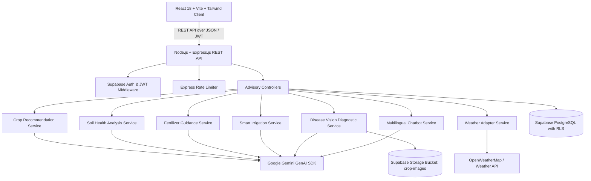

# AgroGuide AI - System Architecture Document

## 1. Executive Summary
**AgroGuide AI** is an intelligent, full-stack agricultural decision support platform engineered specifically for Indian farmers. It bridges state-of-the-art Generative AI (Google Gemini 2.5) with empirical agronomic models, localized soil chemistry analysis, weather forecasts, and visual plant pathology diagnostics.

---

## 2. Architecture Overview

---

## 3. Technology Stack

### Frontend
- **Framework:** React 18 with Vite
- **Language:** TypeScript
- **State Management & Router:** React Context (Auth, Language) & React Router v6
- **Styling:** Tailwind CSS with mobile-first responsive layout
- **Forms & Validation:** React Hook Form & Zod
- **Icons:** Lucide React
- **Data Visualizations:** Recharts

### Backend
- **Runtime:** Node.js LTS (v24+)
- **Framework:** Express.js (REST architecture)
- **Language:** TypeScript
- **Validation:** Zod schema validation on all inputs & outputs
- **File Ingestion:** Multer (memory buffer, magic-byte signature verification, 5MB limit)
- **Rate Limiting:** Express Rate Limit
- **Security:** Helmet-style header isolation, CORS, Parameterized DB queries

### Database & Security
- **Engine:** Supabase PostgreSQL
- **Security Isolation:** PostgreSQL Row Level Security (RLS) on all 11 user-owned tables
- **Storage:** Private Supabase Storage bucket (`crop-images`) with user-isolated RLS policies
- **Triggers:** Automatic `updated_at` timestamps and safe `auth.users` profile synchronization

### AI Engine
- **SDK:** Official `@google/genai`
- **Model:** Configurable via `GEMINI_MODEL` (default: `gemini-2.5-flash`)
- **Safety:** Agricultural safety guardrails preventing guaranteed yield assertions, unauthorized pesticide recommendations, and uncertainty masking

---

## 4. Database Schema and Isolation (RLS)
The database enforces strict tenant isolation:
- `public.profiles`: User personal details and preferred regional language (`en`, `hi`, `kn`, `te`, `ta`, `ml`).
- `public.farms`: Farmer agricultural plots, locations, land area, dominant soil types.
- `public.soil_records`: Laboratory and field test parameters (pH, N, P, K, Organic Carbon, Moisture).
- `public.crop_recommendations`: Top 5 crop suitability recommendations, estimated scores, duration, and sowing windows.
- `public.soil_analyses`: Diagnostic evaluations of soil health and organic amendments.
- `public.disease_analyses`: Visual leaf inspection metadata, identified diseases, confidence scores, and IPM treatments.
- `public.fertilizer_recommendations`: Stage-specific split fertilizer schedules and biofertilizer alternatives.
- `public.irrigation_recommendations`: Evapotranspiration-aware water management schedules.
- `public.chat_conversations` & `public.chat_messages`: Contextual agricultural dialogues.
- `public.weather_records`: Historical and forecast meteorological records.

Every table enforces `auth.uid() = user_id` for SELECT, INSERT, UPDATE, and DELETE operations.
